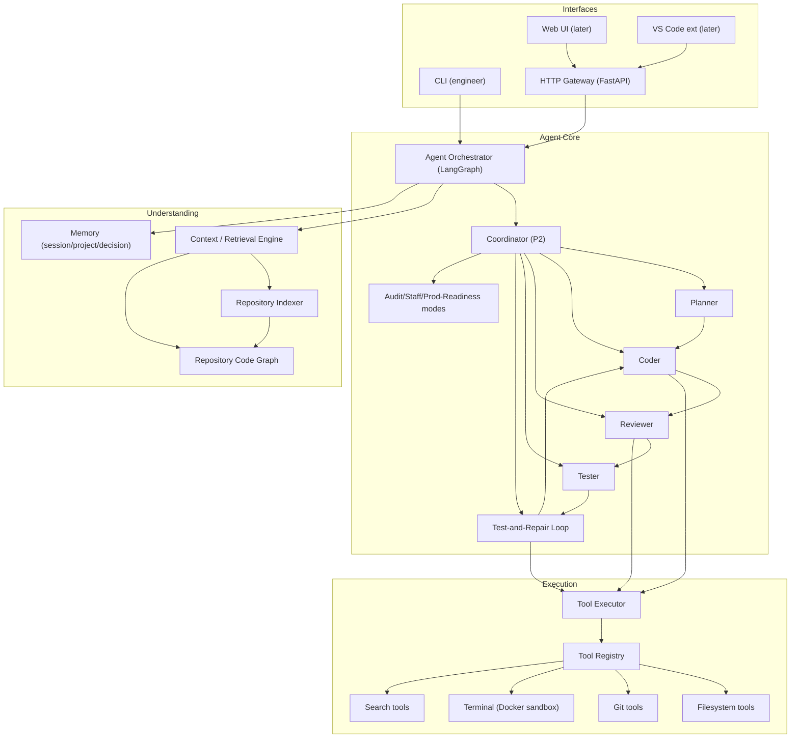

# Target Architecture

The end-state architecture for the `coding-agent` project, derived from the
project specification and constrained by the existing implementation
(see `docs/PROJECT_GAP_ANALYSIS.md`).

Guiding principles:

- **Modular monolith.** No microservices unless load actually demands it.
- **Interface-independent core.** CLI, Web UI, and VS Code extension are thin
  adapters over the same agent core.
- **Do not rewrite working functionality.** The LangGraph orchestration,
  sandboxed tools, and durable persistence are reused as-is.
- **Simple, modular, observable, testable, extensible, secure.**

---

## 1. Target architecture

The **HTTP Gateway, orchestrator, agents, tools, and executor already exist**
and remain the core. The new surface is the **CLI**, the **understanding
layer** (indexer, retrieval, code graph, memory), and the **modes** that sit
on top of the loop (test-and-repair, review/audit, system design,
distributed-systems analysis).

> **Status (current, through Phase 20):** every item below is implemented —
> CLI, indexer/retrieval (embeddings + semantic search), code graph, memory,
> test-and-repair, review/audit/arch/design/analyze/modernize modes, auth +
> workspace/session APIs, observability, evals, coordinator/parallel
> specialists, MCP integration, CI/CD + K8s deployment, and a Web UI at
> `/ui`. The **only unbuilt interface is the VS Code extension**. See
> `docs/ARCHITECTURE_AND_SETUP.md` for the authoritative current-state
> description.

---

## 2. Module mapping (existing → target)

| Target component | Existing module | Status |
|---|---|---|
| HTTP Gateway | `app/gateway/` (FastAPI, SSE, retry/cancel) | **Keep.** Auth, workspaces, sessions, UI wired (P1/P2). |
| Agent Orchestrator | `app/orchestrator/orchestrator.py` | **Keep.** |
| Agent loop | `app/agents/base.py` (`LoopAgent`) | **Keep.** |
| Coder | `app/agents/coder.py` | **Keep.** |
| Coordinator (parallel specialists) | `app/agents/coordinator.py` | **Done (P2, item 16).** Dispatch → parallel read-only security/perf specialists → optional coder → synthesis; `READ_ONLY_TOOLS` allowlist. |
| Pipeline (planner/coder/reviewer/tester) | `app/agents/pipeline.py` | **Keep.** Reused by the coordinator and modes. |
| LLM abstraction | `app/llm/` (protocol, openai, anthropic, gemini, factory) | **Keep.** Gemini **done (P1)** — `app/llm/clients/gemini.py`. |
| Tool contracts | `app/tools/` (`ToolCall`/`ToolResult`/`ToolSpec`, registry) | **Keep.** 17 tools incl. `mcp_call`. |
| Tool executor | `app/executor/executor.py` | **Keep.** |
| Terminal sandbox | `app/executor/sandbox.py` | **Keep.** |
| Path confinement | `app/executor/paths.py` | **Keep.** |
| Persistence | `app/database/` (models, repos, Alembic, pgvector) | **Keep.** `code_chunks` + `memory_entries` repos and embedding indexes **done**. |
| Event bus / streaming | `app/orchestrator/broker.py` + SSE routes | **Keep.** Token-level streaming **done (P1)**. |
| **CLI** | `app/cli/` | **Done (P0).** Thin adapter over orchestrator + shared client; 25+ subcommands. |
| **Repository indexer** | `app/retrieval/indexer.py` | **Done (P0).** AST/parser chunking + embeddings; `engineer index`. |
| **Retrieval / context engine** | `app/retrieval/` + `code_chunks` | **Done (P0).** `ContextAssembler` with semantic blend; `embedder.py`. |
| **Code graph** | `app/architecture/` (`deps`, `render`) | **Done (P1).** `engineer graph` text/Mermaid; metrics (hubs/cycles/orphans/layers). |
| **Memory** | `app/memory/` (service + repo) | **Done (P1).** Durable session/project/decision memory; semantic recall; `engineer memory`. |
| **Test-and-repair loop** | `app/agents/pipeline.py` (tester/repair nodes) | **Done (P0).** Real `test_run` parsing + bounded repair (`test_max_repairs`). |
| **Modes** (audit/design/analyze/modernize) | `app/audit/`, `app/architecture/`, `app/design/`, `app/analysis/`, `app/modernization/` | **Done (P1/P2).** audit + arch + design + distributed-systems analysis + modernize all complete. |
| **Observability** | `app/monitoring/` + structlog + OTel | **Done (P1).** Traces/metrics, `InstrumentedLLM`, HTTP middleware. |
| **Evals harness** | `app/evals/` | **Done (P1).** 6 benchmarks, headless runner, JSONL store, `engineer eval`. |
| **Auth** | `app/security/` + `app/gateway/routes/auth.py` | **Done (P1).** register/login/me/password; user-scoped workspaces/sessions. |
| **MCP integration** | `app/mcp/` + `app/tools/specs/mcp.py` | **Done (P2, item 18).** Stdio JSON-RPC client; `mcp_call` tool; `engineer mcp list`. |
| **Web UI** | `app/gateway/routes/ui.py` | **Done (P2, item 20).** Single-page app served at `/ui` over the same gateway. |
| Deployment | `docker-compose.yml`, `infra/*`, `.github/workflows/`, `deploy/k8s/` | **Done (P2, item 19).** CI/CD + K8s manifests (autoscaling optional). |

---

## 3. Architectural decisions for the target state

1. **CLI is an adapter, not a rewrite.** It calls the same
   `Orchestrator`/agents in-process (or the HTTP gateway for remote use). One
   agent core, many frontends.
2. **Retrieval is pluggable and offline-first.** An `Embedder` protocol
   mirrors `LLMProvider`; a local/simple embedder is the default so indexing
   works without a paid API; OpenAI-compatible embeddings are optional.
3. **Context selection is task-specific.** A `ContextAssembler` takes a goal,
   queries the index/code graph, and returns a ranked, size-bounded set of
   files/chunks — never the whole repository.
4. **Real test execution, simulated verdicts removed.** The tester becomes a
   real test runner that parses suite output into structured failures; the
   repair loop (analyze → fix → re-run, bounded attempts) is a first-class
   graph node.
5. **Safety is layered**: sandbox (exists) + command allow/deny rules +
   destructive-command confirmation + approval gate for planning.
6. **LangGraph is the one state-machine.** New modes are new graphs (or
   composed nodes) reusing `LoopAgent`, exactly as the pipeline already does.
7. **Everything is config via env** (pydantic-settings), as today; a YAML
   config file is optional later, never required.

---

## 4. Phased implementation plan

### P0 — Core product (make it genuinely useful)

Order matters; each step keeps the suite green.

1. **P0-A CLI foundation**
   - `engineer` console entry point (session prompt), commands skeleton
     (`init`, `status`, `"task"`, `review`, `test`, `diff`, `commit`).
   - Rich TTY UX: streaming output, progress, tool-visibility, cancellation,
     history, structured errors.
   - Wire the CLI to the in-process orchestrator + a fixture workspace;
     `engineer "goal"` runs `coder` and, on `agent_type`, the pipeline.
2. **P0-B Repository discovery + indexing**
   - `engineer init` / `engineer index`: walk the workspace, detect language
     (Python/Java/TypeScript/JavaScript first), chunk source files into
     `code_chunks`, extract symbols (classes/functions/methods/imports) via
     AST/parser libraries where available.
   - Index service + `CodeChunkRepository`; idempotent re-index.
3. **P0-C Context retrieval**
   - Keyword search (glob → ripgrep-style) + symbol lookup against the index.
   - `ContextAssembler` returning a ranked context window for a goal.
   - Feed assembled context into the loop as an initial system/user context.
4. **P0-D Planning + approval**
   - Structured plan artifact (objective/assumptions/files/deps/risks/
     validation) produced by the planner stage.
   - Approval gate: CLI prompts before execution when the plan involves
     writes/destructive steps; `--yes` for automation.
5. **P0-E Safety controls**
   - Command allow/deny rules + destructive-command confirmation
     (`rm`, `git reset --hard`, `git push --force`, etc.).
   - Add `edit_file` (diff-based) tool so changes are surgical.
6. **P0-F Test execution + test-and-repair loop**
   - `test_run` tool: run the suite in the sandbox, parse output into
     structured failures (pytest/ts-jest/etc.).
   - Repair graph node: analyze failure → fix → re-run, bounded attempts
     (config `test_max_repairs`).
7. **P0-G CLI task completion + tests**
   - Full `engineer "task"` flow: context → plan → approval → execute →
     test-and-repair → review summary → diff.
   - Tests: CLI tests (in-process), indexer tests, retrieval tests, repair
     loop tests, end-to-end fixture-repo golden path.

### P1 — Differentiation

8. **Review/audit modes**: **Done** — `engineer review` (standalone structured
   review with severity/file/line/problem/reason/fix) and `engineer audit`
   (staff-engineer + production-readiness scoring backed by evidence).
9. **Architecture analysis + dependency graph**: **Done** — `engineer graph`
   (deterministic file graph, text + Mermaid, hubs/cycles/orphans/layers) and
   `engineer arch` (LLM analysis seeded by the graph).
10. **Distributed-systems analysis** and **system-design mode**: **Done** —
    `engineer analyze` (deterministic concern scan with `--scan-only` option)
    and `engineer design "…"` (architecture, APIs, data/event model, caching,
    failure handling, scaling, observability, Mermaid diagrams).
11. **Memory**: **Done** — session/project/decision memory, inspectable/editable
    (`engineer memory`, `memory list`, `memory clear`); orchestrator injects
    recalled memory into agent context.
12. **Git workflow**: **Done** — 7 git tools (status, diff, commit, log,
    branch, checkout, push); `engineer commit` with LLM message generation;
    `engineer pr` with LLM-generated title/summary/tests/risks/migration notes
    + `gh pr create` (graceful fallback).
13. **Auth + workspace/session management APIs**: **Done** — register/login/
    me/password; user-scoped workspaces and sessions; ownership checks.
14. **Observability**: **Done** — OTel traces/metrics (LLM calls, tokens,
    duration, tool calls, task runs, HTTP requests), `InstrumentedLLM` wrapper,
    HTTP middleware, token-level streaming to CLI via `_TokenSink`.
15. **Evaluation framework**: **Done** — 6 benchmark tasks, headless
    `EvalRunner`, `ResultStore` (JSONL), `engineer eval list|run|results|compare`
    CLI.

### P2 — Advanced

16. **Coordinator + parallel agents**: intent → dispatch to specialized
    agents (security/perf/testing) when valuable, parallel where safe.
    **Done (Phase 18)** — `CoordinatorAgent` dispatches to read-only
    security/performance specialists (capped by `coordinator_max_specialists`)
    and optionally a coder, then synthesizes. Testing dispatch is a future
    extension.
17. **Legacy modernization**, security/performance analysis modes.
    **Done (Phase 17)** — `engineer modernize` produces a structured
    modernization report (migration steps + findings); security/performance
    analysis delivered via coordinator specialists and `engineer audit`.
18. **MCP tool integration** (GitHub/Jira/DBs/cloud) — tool layer is already
    spec-based; add an MCP adapter. **Done (Phase 18)** — stdio JSON-RPC
    `MCPClient`/`MCPManager`, `mcp_call` tool, `engineer mcp list`.
19. **Deployment**: CI/CD pipeline, K8s manifests + autoscaling, observability
    stack. **Done (Phase 19)** — GitHub Actions CI + release, `deploy/k8s/`
    manifests (autoscaling optional/future), Make targets.
20. **Web UI / VS Code extension** on the same gateway. **Web UI done
    (Phase 20)** — single-page app at `/ui`. VS Code extension is the only
    remaining interface.

---

## 5. Acceptance criteria per phase

- **P0 exit criteria:** **Done.** `engineer "task"` on a fixture repo performs
  context → plan → approval → edits → real test run → repair → review
  summary; `engineer diff` shows surgical changes; destructive commands are
  confirmed; full green unit + integration suites.
- **P1 exit criteria:** **Done.** every mode has tests with a mock LLM; audit
  scores cite evidence; memory is inspectable; auth protects every endpoint;
  evals run 6 benchmark tasks headlessly with result store and model comparison.
- **P2 exit criteria:** **Done.** coordinator + MCP adapter + modernization
  mode + CI/CD & K8s deployment + Web UI (`/ui`) shipped. Current suite:
  122 app modules, 642 tests (541 unit / 101 integration); 7 Windows-only
  failures (CRLF/git output), ruff + `mypy app` clean. Remaining: VS Code
  extension; optional K8s autoscaling/Helm.

---

## 6. Explicit non-goals (for now)

- No microservices split of the monolith.
- No managed Kubernetes/autoscaling tuning beyond the provided manifests.
- No payments/billing, no multi-tenant SaaS wiring.
- No requirement that any mode works without an LLM provider — but every test
  must work with a fake/mock LLM.
